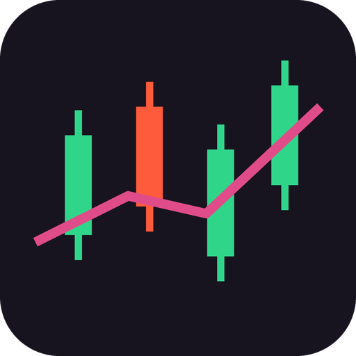

  

<h1 align="center">SessionBar</h1>

  A slim market-session bar for Windows — New York, London and Tokyo session clocks with live countdowns to every open, break, close and pre/post-market change, in one strip that hugs the edge of your screen.

  

<!-- The badge above lights up once this repo's GitHub Actions runs have
     happened; the workflow (build-windows.yml) is in the tree and builds
     every version tag. -->

Every trader keeps a session clock *somewhere* — a website, a second app, a mental note that London closes in forty minutes. SessionBar puts it on your desktop permanently: a borderless, always-on-top bar that shows the state of the three big equity sessions at a glance, updated every second, with nothing to open and nothing to refresh.

## Features

- **Three sessions, three cells:**

  | Cell | Exchange | Regular hours (local) | Time zone |
  |------|----------|----------------------|-----------|
  | **NEW YORK** | NYSE | 09:30 – 16:00, plus PRE 04:00 – 09:30 and POST 16:00 – 20:00 | America/New_York |
  | **LONDON** | LSE | 08:00 – 16:30 | Europe/London |
  | **TOKYO** | TSE | 09:00 – 15:00, lunch 11:30 – 12:30 | Asia/Tokyo |

  Each cell shows the city's name, **that exchange's current local time**, its state — **OPEN** (green), **BREAK** (amber, Tokyo lunch), **PRE** (amber, New York pre-market), **POST** (teal, New York post-market), **CLOSED** (red) — and a **live countdown to the next change**: *"closes in 2h 14m"*, *"opens in 7h 03m"*, *"break in 0h 30m"*, *"resumes in 0h 22m"*, *"ends in 1h 05m"* when post-market is winding down. On weekends the countdown runs to the next session start — no dead clocks on a Saturday.
- **Exchange holidays and early closes are modeled** — the published NYSE, LSE and JPX calendars for **2026–2028** are embedded in the app: full-day holidays produce no session at all (not even a New York pre-market), and early closes end the regular session early (New York post-market still runs to 20:00). Two honest footnotes: Tokyo's 2028 list is *derived* from Japan's statutory holidays (JPX hadn't published 2028 yet), and the LSE's two late-December 2028 early closes are *derived* from the 2023 analogue — both are named as derived in the build log, and every single date is pinned by a unit test.
- **Daylight saving is computed, never assumed** — session times are built as wall-clock times in each exchange's real IANA time zone and converted with the standard C++ time-zone database; there are **no fixed UTC offsets anywhere**. The tricky weeks when the US and Europe change clocks on different dates are pinned by unit tests against the published DST calendars.
- **No network. No accounts. Nothing leaves the machine.** SessionBar's only inputs are your system clock and the operating system's time-zone database. It works on a plane, in a sandbox, anywhere — there is no feed to go down and no staleness to manage, which is exactly how a clock should be.
- **Family behaviour** — drag it where you want (position remembered across restarts), dock it to the **top or bottom** edge, and turn on **Reserve** (event-driven, the family's anti-flicker design) to have Windows keep maximised windows out of its space. **Arrange** slides floating windows clear of the bar; **Restore** puts them back. Settings toggles individual sessions, switches cell clocks between 12h and 24h, and adjusts background style and opacity.
- **One family look** — the default theme is **Midnight Kids**, the MeterBar palette verbatim (all twelve colours plus the styled-background gradients), with **Clean Dark** as the quiet alternative.

## Install

1. Download **`SessionBar-Setup.exe`** from the [Releases](https://github.com/Corporal8065/SessionBar/releases) page.
2. Run it. The installer puts SessionBar in Program Files and adds a Start Menu entry; your settings live outside the app folder, so reinstalling never wipes them.
3. **SmartScreen note:** SessionBar is unsigned (it's a small independent app, not a commercial release), so Windows may show *"Windows protected your PC"*. Click **More info → Run anyway**. The installer is built from this exact source tree by the GitHub Actions workflow in this repo.

## Build from source

You need **Visual Studio 2022** with the *"Desktop development with C++"* workload. No C++ knowledge required — the build is one double-click:

- **`build.bat`** — builds the app for testing (`build-app\app\SessionBar_artefacts\Release\SessionBar.exe`).
- **`build-release.bat`** — builds the shareable installer (`dist\SessionBar-Setup.exe`, needs [Inno Setup 6](https://jrsoftware.org/isdl.php)).

The app version lives in exactly **one** place — the `project(VERSION)` line in the root `CMakeLists.txt` — and everything else (UI, installer, CI) reads from it. All session and countdown math lives in a pure, unit-tested core (`tests/test_core.cpp`): boundary minutes at every open, close and break edge, weekend rollover, both DST-mismatch weeks, and every calendar date.

## Gallery

### Screenshots wanted

No Windows captures of SessionBar exist yet — this section deliberately ships **without** screenshots rather than with borrowed or mock-up images. If you're running SessionBar on Windows, these exact shots would complete the gallery (only real captures of SessionBar itself, please):

- The bar itself docked on a **real Windows desktop**, with one session OPEN and one in PRE or POST
- The bar on a **weekend**, counting down to the next pre-market
- The bar on an **exchange holiday** (e.g. Thanksgiving) showing New York CLOSED all day
- Tokyo's cell in its lunch **BREAK**
- The bar **docked with Reserve on**, a maximised window stopping at the bar
- The **Settings** window (Sessions and Appearance panels)

## The family

SessionBar is one of a small family of edge-of-screen bars. Its siblings live in **their own repositories** (one app, one repo, one release feed each):

- **MeterBar** — a pretty audio meter bar (spectrum, waveform, loudness, stereometer, oscilloscope) — the family's first app, and the source of the shared Midnight Kids look.
- **TickerBar** — a slim crypto ticker bar (live spot prices, 24h/1h change, sparklines, candlestick detail, Fear & Greed, BTC dominance).

---

*Built with [JUCE](https://juce.com) and a hand-rolled session-math core. Made with JUCE — free-license attribution.*
