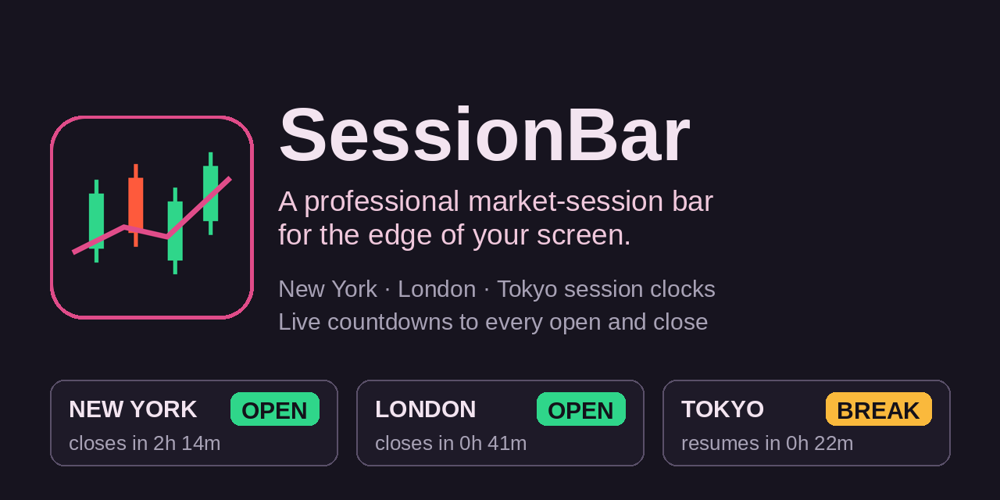

# SessionBar

**A professional market-session bar for Windows** — New York, London and Tokyo session clocks with live countdowns to every open, break and close, in one slim strip that hugs the edge of your screen.

Every trader keeps a session clock *somewhere* — a website, a second app, a mental note that London closes in forty minutes. SessionBar puts it on your desktop permanently: a borderless, always-on-top bar that shows the state of the three big equity sessions at a glance, updated every second, with nothing to open and nothing to refresh.

## What it does

### Three sessions, three cells

| Cell | Exchange | Regular hours (local) | Time zone |
|------|----------|----------------------|-----------|
| **NEW YORK** | NYSE | 09:30 – 16:00 | America/New_York |
| **LONDON** | LSE | 08:00 – 16:30 | Europe/London |
| **TOKYO** | TSE | 09:00 – 15:00, lunch 11:30 – 12:30 | Asia/Tokyo |

Each cell shows the city's name, **that exchange's current local time**, its state — **OPEN** (green), **BREAK** (amber), **CLOSED** (red) — and a **live countdown to the next change**:

- *"closes in 2h 14m"* while a session is open
- *"opens in 7h 03m"* while it's closed
- *"break in 0h 30m"* during Tokyo's morning, *"resumes in 0h 22m"* during its lunch break
- On weekends, the countdown runs to **Monday's open** — no dead clocks on a Saturday

### Daylight saving is computed, never assumed

Session times are built as wall-clock times in each exchange's real IANA time zone and converted with the standard C++ time-zone database — there are **no fixed UTC offsets anywhere** in the app. The tricky weeks when the US and Europe change clocks on different dates (March, and late October / early November) are pinned by unit tests against the published DST calendars, so the countdowns stay right exactly when hand-rolled clocks go wrong.

### Honest about its one limit

**Exchange holidays are not modeled in v0.1.** The bar follows the regular Monday–Friday schedule; on an exchange holiday a cell will say OPEN when the market is actually shut. This is stated here and in the app's own tooltip — a clock that admits its limits beats one that quietly lies. Holiday calendars are the planned next step.

### No network. No accounts. Nothing leaves the machine.

SessionBar's only inputs are your system clock and the operating system's time-zone database. It works on a plane, in a sandbox, anywhere — there is no feed to go down and no staleness to manage, which is exactly how a clock should be.

### Family behaviour

SessionBar is a sibling of MeterBar and TickerBar and behaves like one: drag it where you want (position remembered across restarts), dock it to the **top or bottom** edge, and turn on **Reserve** to have Windows keep maximised windows out of its space. **Arrange** slides floating windows clear of the bar; **Restore** puts them back. Settings lets you toggle individual sessions, switch cell clocks between 12h and 24h, and adjust background style and opacity. The default theme is **Midnight Kids** — the MeterBar palette, verbatim — with **Clean Dark** as the quiet alternative.

## Install

Installers are published on the [Releases](https://github.com/Corporal8065/SessionBar/releases) page — the first release is **v0.1**. Download `SessionBar-Setup.exe`, run it, and the sessions are on your screen.

**SmartScreen note:** SessionBar is an unsigned independent app, so Windows may show *"Windows protected your PC"* the first time. Click **More info → Run anyway**. Release installers are built from this source tree by the GitHub Actions workflow in this repository.

## Build from source

You need **Visual Studio 2022** with the *"Desktop development with C++"* workload:

- **`build.bat`** — builds the app for testing.
- **`build-release.bat`** — builds the shareable installer (needs [Inno Setup 6](https://jrsoftware.org/isdl.php)).

Built with [JUCE](https://juce.com). All session and countdown math lives in a pure, unit-tested core — boundary minutes at every open, close and break edge, weekend rollover, and both DST-mismatch weeks are covered.

## The family

SessionBar is one of a small family of edge-of-screen bars — one app, one repo each:

- **MeterBar** — a professional audio meter bar (spectrum, waveform, loudness, stereometer, oscilloscope).
- **TickerBar** — a slim crypto ticker bar (live spot prices, 24h change, sparklines, Fear & Greed, BTC dominance).
